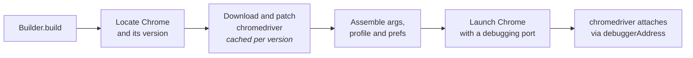

<div align="center">

# undetected-chromedriver-java

**A Selenium `ChromeDriver` that doesn't announce itself as a bot.**

Java 25 / Selenium 4 port of [ultrafunkamsterdam/undetected-chromedriver](https://github.com/ultrafunkamsterdam/undetected-chromedriver) v3.5.5.

[](https://central.sonatype.com/artifact/io.github.andreygrigoriev/undetected-chromedriver-java)
[](https://openjdk.org/projects/jdk/25/)
[](https://www.selenium.dev/)
[](https://github.com/ultrafunkamsterdam/undetected-chromedriver)
[](LICENSE)
<br>
[](#requirements)
[](#docker)
[](https://github.com/andreygrigoriev/undetected-chromedriver-java/stargazers)

[Install](#install) •
[Quick start](#quick-start) •
[Recipes](#recipes) •
[Coming from Python](#coming-from-python) •
[Troubleshooting](#troubleshooting) •
[Docker](#docker)

</div>

---

## Why

A stock ChromeDriver session is easy to detect: chromedriver injects `cdc_` globals into every page and launches the browser with automation flags. This library patches the chromedriver binary, launches Chrome itself, and then lets chromedriver attach through `debuggerAddress`.

`UndetectedChromeDriver` **extends `ChromeDriver`**, so it works anywhere a `WebDriver`, `JavascriptExecutor`, `HasCdp` or `TakesScreenshot` is accepted. Your existing Selenium code keeps working.

## Features

| | |
|---|---|
| 🩹 **Patched chromedriver** | `cdc_` markers removed from the binary, cached per Chrome version |
| 🎯 **Version matching** | Finds your installed Chrome and downloads the matching driver (Chrome-for-Testing and legacy storage) |
| 🚀 **Browser launched by Chrome, not chromedriver** | No automation flags. The driver attaches over the remote debugging port |
| 👻 **Headless evasions** | Removes `Headless` from the user agent and patches `navigator` and `window.chrome` |
| 📡 **CDP events** | Subscribe to any DevTools event with a plain `Consumer<Map<String, Object>>` |
| 🔁 **Reconnect** | Detach and reattach the driver around a sensitive action (e.g. a challenge page) |
| 🧭 **Recursive search** | `findElementsRecursive` looks through every iframe |
| 🐳 **Docker image** | Chrome under Xvfb for headful runs on servers |

## Requirements

- **Java 25** or newer
- **Google Chrome or Chromium** installed (or pass `browserExecutablePath`)
- Linux x64, macOS (Intel or Apple Silicon), or Windows
- Network access on first launch for a given Chrome version, to download chromedriver

## Install

<details open>
<summary><b>Maven</b></summary>

```xml
<dependency>
    <groupId>io.github.andreygrigoriev</groupId>
    <artifactId>undetected-chromedriver-java</artifactId>
    <version>0.1.0</version>
</dependency>
```

</details>

<details>
<summary><b>Gradle (Kotlin DSL)</b></summary>

```kotlin
implementation("io.github.andreygrigoriev:undetected-chromedriver-java:0.1.0")
```

</details>

<details>
<summary><b>Gradle (Groovy DSL)</b></summary>

```groovy
implementation 'io.github.andreygrigoriev:undetected-chromedriver-java:0.1.0'
```

</details>

## Quick start

```java
import io.github.andreygrigoriev.uc.UndetectedChromeDriver;

UndetectedChromeDriver driver = UndetectedChromeDriver.newBuilder().build();
try {
    driver.get("https://example.com");
    System.out.println(driver.getTitle());
} finally {
    driver.quit();
}
```

That's it. On first run the library finds Chrome, downloads the matching chromedriver, patches it, and caches it.

> [!NOTE]
> The factory is named `newBuilder()` because `ChromeDriver.builder()` is a public static method and can't be hidden with a different return type.

## How it works



If any step fails, everything created so far (browser process, temporary profile, driver service) is cleaned up.

## Recipes

### Your own `ChromeOptions`

```java
ChromeOptions options = new ChromeOptions();
options.addArguments("--window-size=1280,800", "--lang=en-US");

UndetectedChromeDriver driver = UndetectedChromeDriver.newBuilder()
        .options(options)
        .build();
```

### Persistent profile (stay logged in)

```java
UndetectedChromeDriver driver = UndetectedChromeDriver.newBuilder()
        .userDataDir(Path.of("profiles/main"))
        .build();
```

A directory you pass in is kept after `quit()`. Without one, a temporary profile is created and deleted on `quit()`. You can also set it on the options with `new UndetectedChromeOptions().userDataDir(path)`. An `UndetectedChromeOptions` instance can only be used for one driver.

### Headless

```java
UndetectedChromeDriver driver = UndetectedChromeDriver.newBuilder()
        .headless(true)
        .build();
```

See [Headless caveats](#headless-caveats).

### Pin the Chrome version or binary

```java
UndetectedChromeDriver driver = UndetectedChromeDriver.newBuilder()
        .browserExecutablePath(Path.of("/opt/chrome/chrome"))
        .versionMain(130)
        .build();
```

### Listen to CDP events

```java
UndetectedChromeDriver driver = UndetectedChromeDriver.newBuilder()
        .enableCdpEvents(true)
        .build();
driver.addCdpListener("Network.requestWillBeSent", event -> System.out.println(event));
driver.addCdpListener("*", event -> { /* every event */ });
```

Events are delivered by polling the `performance` log once a second, as upstream does, on a single thread and in order. There is one handler per event name: a later registration replaces the earlier one. `addCdpListener` returns `false` when CDP events were not enabled.

### Get past a challenge page with `reconnect`

```java
driver.get("https://protected.example");
driver.reconnect(Duration.ofSeconds(5)); // detach, wait, reattach
```

While detached, the page sees no chromedriver connection at all.

### Tabs, windows, and iframes

```java
driver.tabNew("https://example.com/other");   // new tab via DevTools
String handle = driver.windowNew();            // new window, returns its handle

for (WebElement el : driver.findElementsRecursive(By.cssSelector("button"))) {
    // matches inside every iframe; the driver is switched into the element's frame
}
```

### Advanced elements

```java
UndetectedChromeDriver driver = UndetectedChromeDriver.newBuilder()
        .advancedElements(true)
        .build();

UcWebElement link = (UcWebElement) driver.findElement(By.tagName("a"));
link.attrs();                    // all attributes, fetched once
link.children("span", true);    // descendants by tag
link.clickSafe();                // click, then reconnect
```

### Driver API cheat sheet

| Method | What it does |
|---|---|
| `reconnect(Duration)` | Stop the driver service, wait, start a new one attached to the same browser |
| `tabNew(url)` | Open a tab through the DevTools HTTP endpoint |
| `windowNew()` | Open a window and return its handle |
| `findElementsRecursive(By)` | Search the page and every iframe |
| `addCdpListener(event, listener)` / `clearCdpListeners()` | CDP event handlers (needs `enableCdpEvents(true)`) |
| `cdp()` | Low-level DevTools client (`/json/*` HTTP and WebSocket) |
| `browserPid()` | PID of the Chrome process |
| `userDataDir()` | Profile directory in use |

## Coming from Python

Every argument of the Python `uc.Chrome(...)` constructor maps to a builder method:

<details>
<summary><b>Python argument → builder method</b></summary>

| Python argument | Builder method |
|---|---|
| `options` | `options(ChromeOptions)` |
| `user_data_dir` | `userDataDir(Path)` |
| `driver_executable_path` | `driverExecutablePath(Path)` |
| `browser_executable_path` | `browserExecutablePath(Path)` |
| `port` | `port(int)` (0 picks a free port) |
| `enable_cdp_events` | `enableCdpEvents(boolean)` |
| `advanced_elements` | `advancedElements(boolean)` |
| `log_level` | `logLevel(int)` |
| `headless` | `headless(boolean)` |
| `version_main` | `versionMain(int)` |
| `patcher_force_close` | `patcherForceClose(boolean)` |
| `suppress_welcome` | `suppressWelcome(boolean)` (default true) |
| `use_subprocess` | `useSubprocess(boolean)` (default true) |
| `debug` | `debug(boolean)` |
| `no_sandbox` | `noSandbox(boolean)` (default true) |
| `user_multi_procs` | `userMultiProcs(boolean)` |
| `**kw` (service args / log) | `serviceLogFile(File)` |
| `desired_capabilities` | dropped: set capabilities on `options` |
| `keep_alive` | dropped: Selenium Java's `ClientConfig` has no toggle |

</details>

<details>
<summary><b>Known differences from upstream</b></summary>

- Patched binaries are cached per Chrome version in the data dir (`undetected_chromedriver_<version>`) instead of being downloaded on every launch. The binary is never deleted.
- The driver version follows the installed Chrome (detected automatically; override with `versionMain`) instead of always using the latest Stable.
- `user_multi_procs` is a real lock (a thread lock plus a file lock on `<dataDir>/.lock`).
- Only arguments starting with `--headless` are removed from user args. Upstream removed any argument containing "headless".
- Fixed JavaScript in the headless evasions, `PUT /json/new` for new tabs (Chrome 111+), a macOS arm64 driver, and drained browser output pipes.
- `desired_capabilities` and `keep_alive` are dropped (see the table).
- `--no-sandbox` is appended unconditionally, as upstream does.

</details>

## Headless caveats

`headless(true)` passes `--headless=new` (Chrome 108+, or when the version is unknown) or `--headless=chrome`. The driver then applies evasions: it overrides the user agent to drop `Headless` and injects scripts that fix `navigator` and `window.chrome`.

> [!TIP]
> Headful mode is less detectable. On a machine without a display, use the [Docker image](#docker), which runs a headful Chrome under Xvfb.

## Troubleshooting

<details>
<summary><b>A <code>CdpVersionFinder</code> WARNING on every launch</b></summary>

Selenium's `ChromiumDriver` opens a CDP connection on startup. Without a matching `selenium-devtools-vNNN` artifact on the classpath, `CdpVersionFinder` logs a `java.util.logging` WARNING on every launch. It's harmless. To silence it, add the matching `selenium-devtools-v<N>` dependency, or raise the level:

```java
java.util.logging.Logger.getLogger("org.openqa.selenium.devtools.CdpVersionFinder")
        .setLevel(java.util.logging.Level.SEVERE);
```

</details>

<details>
<summary><b>Where are the patched drivers stored?</b></summary>

| OS | Data dir |
|---|---|
| Linux | `~/.local/share/undetected_chromedriver` |
| macOS | `~/Library/Application Support/undetected_chromedriver` |
| Windows | `%USERPROFILE%\AppData\Roaming\undetected_chromedriver` |
| AWS Lambda | `/tmp/undetected_chromedriver` |

Delete a `undetected_chromedriver_<version>` folder to force a fresh download and patch.

</details>

<details>
<summary><b>Wrong driver version / "This version of ChromeDriver only supports…"</b></summary>

The major version is read from the installed Chrome. If you run a different binary than the one detected, pass `browserExecutablePath(...)`, or force the version with `versionMain(N)`.

</details>

<details>
<summary><b>Several JVMs or threads start drivers at once</b></summary>

The download and patch step is always serialized with a thread lock and a file lock on `<dataDir>/.lock`. Enable `userMultiProcs(true)` to skip it entirely and reuse the newest driver that is already patched in the data dir.

</details>

<details>
<summary><b>Chrome crashes in a container</b></summary>

Give it a bigger `/dev/shm` (`--shm-size=2g`). `--no-sandbox` is already appended.

</details>

## Docker

The image runs the tests under Xvfb, with Google Chrome installed. It is `linux/amd64` only: there's no linux-arm64 Google Chrome and Chrome-for-Testing publishes no linux-arm64 chromedriver, so on Apple Silicon it runs under emulation.

```sh
docker build -t uc-java .
docker run --rm --shm-size=2g uc-java
```

Chrome needs a bigger `/dev/shm`, hence `--shm-size=2g`. The default command is `./mvnw -B verify`. To run your own project, mount it and override the command:

```sh
docker run --rm --shm-size=2g -v "$PWD":/app uc-java ./mvnw -B verify
```

## Building from source

```sh
./mvnw test     # unit tests, no browser needed
./mvnw verify   # plus browser integration tests (needs Chrome and network)
```

Integration tests are skipped automatically when no Chrome is found.

## Contributing

Issues and pull requests are welcome at [GitHub Issues](https://github.com/andreygrigoriev/undetected-chromedriver-java/issues). For a bug report, include your OS, Chrome version and the stack trace.

## Credits

All the detection-evasion ideas come from [undetected-chromedriver](https://github.com/ultrafunkamsterdam/undetected-chromedriver) by ultrafunkamsterdam. This project is an independent Java port.

## License

[GPL-3.0](LICENSE), as is upstream.

<div align="center">

If this saves you some time, consider giving it a ⭐

</div>
